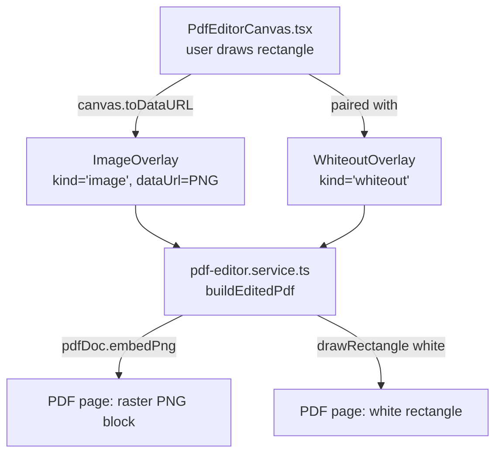
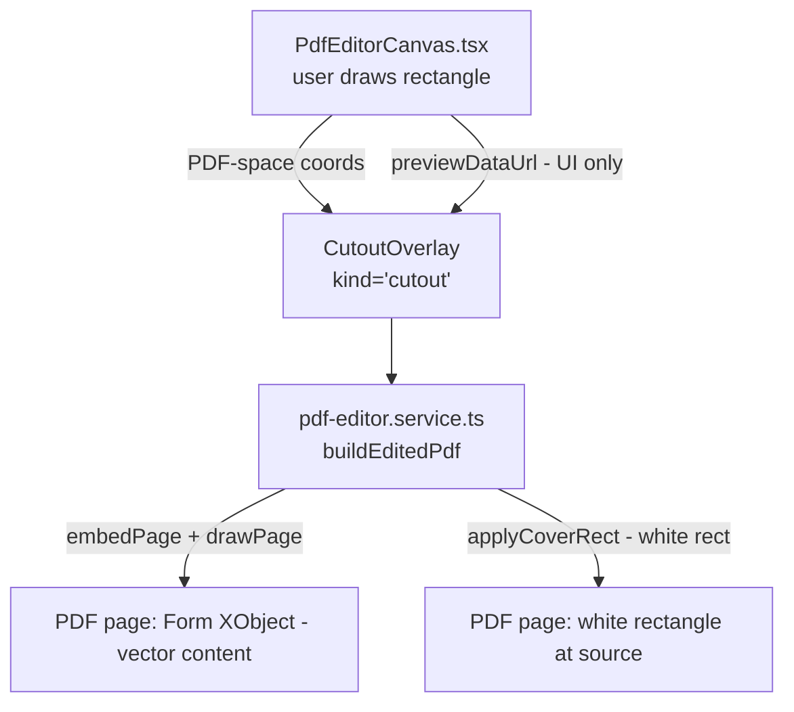
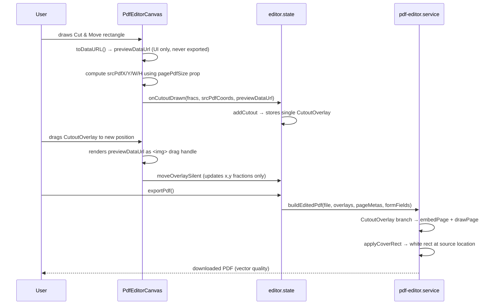

# Design Document: cut-move-quality-fix

## Overview

The Cut & Move tool currently rasterizes a selected PDF region via `canvas.toDataURL('image/png')`
at screen resolution, stores the result as an `ImageOverlay`, and embeds it as a PNG when exporting.
This permanently degrades text and vector content to a blurry screenshot.

This fix introduces a `CutoutOverlay` type that stores source coordinates in PDF-space.
At export time the system reconstructs the moved region using a pdf-lib Form XObject —
a native PDF mechanism that preserves full vector/text fidelity.
The raster preview is kept solely as a drag-UI hint; it never reaches the exported file.

---

## Bug Details

### Current Behavior (Defect)

**1.1** When the user draws a Cut & Move rectangle, `PdfEditorCanvas.tsx` calls
`tempCanvas.toDataURL('image/png')` on the pdfjs-rendered canvas and passes the data-URL
to `addCutout` in `editor.state.ts` via `onCutoutDrawn`.

**1.2** `addCutout` stores the data-URL inside an `ImageOverlay` (`kind: 'image'`) and also
creates a paired `WhiteoutOverlay` (`kind: 'whiteout'`). Both are pushed into `state.overlays`
with no flag marking their Cut & Move origin, making them indistinguishable from user-placed
whiteout/image overlays.

**1.3** In `pdf-editor.service.ts`, `buildEditedPdf` hits the `overlay.kind === 'image'` branch,
calls `pdfDoc.embedPng(imgBytes)`, and draws the result with `page.drawImage()`. The PNG was
captured at screen resolution (~72–96 dpi equivalent), so text and vector lines are blurry.

**1.4** The paired `WhiteoutOverlay` writes an unconditional `rgb(1,1,1)` rectangle.

**1.5** If the user resizes or repositions the cutout overlay, the fixed-resolution raster is
stretched by `page.drawImage()`'s `width`/`height` arguments, degrading quality further.

### Defective code path

```
PdfEditorCanvas.tsx
  handleCanvasMouseUp (toolMode === 'cutout')
    └─ tempCanvas.toDataURL('image/png')              ← raster capture
    └─ onCutoutDrawn(x, y, w, h, dataUrl)

editor.state.ts
  addCutout(x, y, w, h, dataUrl)
    └─ pushes WhiteoutOverlay + ImageOverlay          ← bug: ImageOverlay used for export

pdf-editor.service.ts
  buildEditedPdf → overlay.kind === 'image'
    └─ pdfDoc.embedPng(imgBytes)                      ← bug: raster embedded
    └─ page.drawImage(embedded, ...)                  ← blurry output
```

---

## Expected Behavior

**2.1** When the user draws a Cut & Move rectangle, `PdfEditorCanvas.tsx` SHALL compute the
source rectangle in PDF-space (using a `pagePdfSize` prop) and pass those coordinates to
`addCutout` alongside the raster preview.

**2.2** `addCutout` SHALL store a single `CutoutOverlay` (`kind: 'cutout'`) carrying both the
PDF-space source coordinates and the raster preview URL. No `WhiteoutOverlay + ImageOverlay`
pair is created.

**2.3** In `buildEditedPdf`, when processing a `CutoutOverlay`, the system SHALL use
`pdfDoc.embedPage(srcPage, boundingBox)` to create a Form XObject wrapping the source region,
then stamp it at the destination with `page.drawPage(xobj, { x, y, width, height })`.
Text glyphs and vector paths are preserved.

**2.4** The source region SHALL be covered with `applyCoverRect`, which draws a solid white
rectangle. This is v1 behavior with a documented limitation (see Known Limitations).

**2.5** The drag UI SHALL render `previewDataUrl` as a visible `` during editing.
`buildEditedPdf` SHALL never read `previewDataUrl`.

---

## Hypothesized Root Cause

`addCutout` was written to reuse the existing `ImageOverlay` type because it stores a raster
image and a position — a structural match for the Cut & Move preview. `buildEditedPdf` has no
way to distinguish a user-dropped image from a Cut & Move capture because both share
`kind: 'image'`.

The missing abstraction is a dedicated `CutoutOverlay` that carries both the raster preview
(for the UI) and the PDF-space source coordinates (for the export).

---

## Architecture Overview

### Current overlay system



### Fixed overlay system



### Interaction sequence



---

## Fix Implementation

### 1. New `CutoutOverlay` type — `editor/editor.types.ts`

```typescript
export interface CutoutOverlay extends BaseOverlay {
  kind: 'cutout';

  /** Source region in PDF-space (points, bottom-up Y origin, immutable after creation) */
  srcPdfX: number;
  srcPdfY: number;
  srcPdfW: number;
  srcPdfH: number;

  /** originalIndex of the source page (stable through reorder/delete) */
  srcPageIndex: number;

  /** Destination size in canvas-fraction space (0–1) */
  width: number;
  height: number;

  /**
   * Raster preview for drag UI only.
   * MUST NEVER be read by buildEditedPdf or any export path.
   */
  previewDataUrl: string;

  opacity: number;
}

export type Overlay =
  | TextOverlay
  | WhiteoutOverlay
  | ImageOverlay
  | SignatureOverlay
  | CutoutOverlay;   // added
```

Comparison with `ImageOverlay`:

| Property | `ImageOverlay` | `CutoutOverlay` |
|---|---|---|
| `kind` | `'image'` | `'cutout'` |
| `dataUrl` | canonical export source | UI preview — export-forbidden |
| source geometry | none | `srcPdfX/Y/W/H` in PDF-points |
| export mechanism | `pdfDoc.embedPng` | `pdfDoc.embedPage` + `page.drawPage` |

### 2. Deriving `pagePdfSize` — `PdfEditor/index.tsx`

`PdfEditorCanvas` needs the current page's PDF-point dimensions to convert canvas fractions
to PDF-space coordinates. The cleanest approach is to load a separate `PDFDocument` instance
once at file-load time, extract all page sizes, and pass the active page's size down as a prop.

```typescript
// In PdfEditor/index.tsx — alongside useEditorState()
const [pagePdfSizes, setPagePdfSizes] = useState<Array<{ width: number; height: number }>>([]);

// Triggered when state.file changes
useEffect(() => {
  if (!state.file) { setPagePdfSizes([]); return; }
  (async () => {
    const { PDFDocument } = await import('pdf-lib');
    const buf = await state.file.file.arrayBuffer();
    const doc = await PDFDocument.load(buf, { ignoreEncryption: true });
    setPagePdfSizes(doc.getPages().map(p => p.getSize()));
  })();
}, [state.file]);

// Derived prop for the active page
const activeOriginalIndex = state.pageMetas[state.activePage]?.originalIndex ?? state.activePage;
const pagePdfSize = pagePdfSizes[activeOriginalIndex] ?? { width: 595, height: 842 }; // A4 fallback
```

Pass `pagePdfSize` as a new prop to `PdfEditorCanvas`.

### 3. Canvas-to-PDF coordinate conversion — `PdfEditorCanvas.tsx`

Add `pagePdfSize: { width: number; height: number }` to the `Props` interface.

```typescript
// handleCanvasMouseUp — cutout branch (updated)
const { width: pdfW, height: pdfH } = pagePdfSize;

// canvas fractions → PDF-points (Y axis flipped: canvas top = PDF bottom)
const srcPdfX =  whiteoutRect.x * pdfW;
const srcPdfY = (1 - whiteoutRect.y - whiteoutRect.h) * pdfH;
const srcPdfW =  whiteoutRect.w * pdfW;
const srcPdfH =  whiteoutRect.h * pdfH;

const dataUrl = tempCanvas.toDataURL('image/png');  // UI preview only

onCutoutDrawn(
  whiteoutRect.x, whiteoutRect.y, whiteoutRect.w, whiteoutRect.h,
  srcPdfX, srcPdfY, srcPdfW, srcPdfH,
  dataUrl,
);
```

Update `onCutoutDrawn` prop signature:
```typescript
onCutoutDrawn: (
  x: number, y: number, w: number, h: number,
  srcPdfX: number, srcPdfY: number, srcPdfW: number, srcPdfH: number,
  previewDataUrl: string,
) => void;
```

### 4. Updated `addCutout` — `editor/editor.state.ts`

Replaces the `WhiteoutOverlay + ImageOverlay` pair with a single `CutoutOverlay`.

```typescript
const addCutout = useCallback((
  x: number, y: number, w: number, h: number,
  srcPdfX: number, srcPdfY: number, srcPdfW: number, srcPdfH: number,
  previewDataUrl: string,
) => {
  if (!state.file) return;
  const pageIdx = state.pageMetas[state.activePage]?.originalIndex ?? state.activePage;
  const overlay: CutoutOverlay = {
    id: uid(), kind: 'cutout',
    pageIndex: pageIdx,
    x, y, width: w, height: h,
    srcPdfX, srcPdfY, srcPdfW, srcPdfH,
    srcPageIndex: pageIdx,
    previewDataUrl,
    opacity: 1.0,
  };
  setState(prev => {
    history.push(snapshot(prev));
    return { ...prev, overlays: [...prev.overlays, overlay], selectedId: overlay.id, toolMode: 'select' };
  });
}, [state.file, state.activePage, state.pageMetas, history]);
```

### 5. Form XObject export branch — `editor/pdf-editor.service.ts`

```typescript
if (overlay.kind === 'cutout') {
  const srcPage  = pages[overlay.srcPageIndex];
  const destPage = pages[overlay.pageIndex];
  if (!srcPage || !destPage) continue;

  const { width: dw, height: dh } = destPage.getSize();

  // Clip the source region using PageBoundingBox (PDF bottom-up Y convention)
  const boundingBox = {
    left:   overlay.srcPdfX,
    bottom: overlay.srcPdfY,
    right:  overlay.srcPdfX + overlay.srcPdfW,
    top:    overlay.srcPdfY + overlay.srcPdfH,
  };

  // embedPage copies the page content stream into a Form XObject.
  // On failure (e.g. encrypted stream), let the error propagate — no raster fallback.
  const xobj = await pdfDoc.embedPage(srcPage, boundingBox);

  // Destination rect: canvas-fraction → PDF-points, Y axis flipped
  const dx  =  overlay.x * dw;
  const dy  = (1 - overlay.y - overlay.height) * dh;
  const dw2 =  overlay.width  * dw;
  const dh2 =  overlay.height * dh;

  // Cover the source region BEFORE stamping the destination
  applyCoverRect(destPage, overlay);

  // drawPage writes a cm (transformation matrix) operator — no rasterization
  destPage.drawPage(xobj, { x: dx, y: dy, width: dw2, height: dh2, opacity: overlay.opacity });
}
```

Wrap the entire cutout branch in a try/catch that re-throws with a clear message:

```typescript
try {
  // ... embedPage + drawPage as above ...
} catch (err: any) {
  throw new Error(
    `Cut & Move export failed: the source region could not be embedded as vector content. ` +
    `Try redrawing the selection. (${err?.message ?? 'unknown error'})`
  );
}
```

This error propagates to `exportEditedPdf` → `exportPdf` → `state.error`, which renders it
in the existing red status bar. No silent raster fallback is ever attempted.

### 6. `applyCoverRect` helper — `editor/pdf-editor.service.ts`

```typescript
function applyCoverRect(page: PDFPage, overlay: CutoutOverlay): void {
  // v1: draws a solid white rectangle over the source region.
  // See "Known Limitations" for the documented constraint.
  page.drawRectangle({
    x:      overlay.srcPdfX,
    y:      overlay.srcPdfY,
    width:  overlay.srcPdfW,
    height: overlay.srcPdfH,
    color:  rgb(1, 1, 1),
    opacity: 1,
  });
}
```

### 7. Canvas rendering of `CutoutOverlay` — `PdfEditor/PdfEditorCanvas.tsx`

`OverlayElement` gets a new branch. It reuses the same drag/resize infrastructure as
`ImageOverlay`. The `previewDataUrl` is rendered as a visible `` for the drag UI only.

```typescript
if (overlay.kind === 'cutout') {
  const w = overlay.width  * dims.w;
  const h = overlay.height * dims.h;
  return (
    <div
      style={{ ...baseStyle, width: w, height: h, overflow: 'visible' }}
      className={`absolute ${selectionClass}`}
      onMouseDown={handleMouseDown}
    >
      {isSelected && (
        <FloatingPropertiesPanel
          overlay={overlay}
          onUpdate={onUpdate}
          onUpdateSilent={onUpdateSilent}
          onCaptureSnapshot={onCaptureSnapshot}
          onDelete={onDelete}
        />
      )}
      
      {isSelected && (
        <ResizeHandles
          overlay={overlay}
          dims={dims}
          onResize={onResize}
          onCommitResize={onCommitResize}
          keepAspect={false}
        />
      )}
    </div>
  );
}
```

### 8. PDF transformation matrix for resize/reposition

When the user drags or resizes a `CutoutOverlay`, only `overlay.x/y/width/height`
(canvas-fraction space) change. `srcPdfX/Y/W/H` are immutable after creation.

`destPage.drawPage(xobj, { x, y, width, height })` writes the cm operator:

```
[ dw2/xobj.width   0                  0 ]
[ 0                dh2/xobj.height    0 ]
[ dx               dy                 1 ]
```

where `xobj.width = srcPdfW` and `xobj.height = srcPdfH` (the bounding box dimensions).
No rasterization occurs. Text glyphs and vector paths scale through the matrix cleanly.

### 9. File-level change map

| File | Change |
|---|---|
| `editor/editor.types.ts` | Add `CutoutOverlay` interface; add to `Overlay` union |
| `editor/editor.state.ts` | Rewrite `addCutout`; update `onCutoutDrawn` call signature |
| `editor/pdf-editor.service.ts` | Add `'cutout'` branch with error propagation; add `applyCoverRect` |
| `PdfEditor/PdfEditorCanvas.tsx` | Add `pagePdfSize` prop; update `onCutoutDrawn` signature; render `CutoutOverlay` |
| `PdfEditor/index.tsx` | Derive `pagePdfSizes` at file-load; pass `pagePdfSize` to `PdfEditorCanvas` |

No changes to: `editor.history.ts`, `editor.utils.ts`, `PdfEditorToolbar.tsx`,
`PdfEditorPageThumbnails.tsx`, `PdfEditorProperties.tsx`, `SignaturePad.tsx`.

---

## pdf-lib API Validation

**Installed version: 1.17.1** (verified from `node_modules/pdf-lib/package.json`)

### `PDFDocument.embedPage` — verified signature

```typescript
embedPage(
  page: PDFPage,
  boundingBox?: PageBoundingBox,
  transformationMatrix?: TransformationMatrix
): Promise<PDFEmbeddedPage>
```

`PageBoundingBox` (verified from `cjs/core/embedders/PDFPageEmbedder.d.ts`):

```typescript
interface PageBoundingBox {
  left:   number;  // PDF-points from page left edge
  bottom: number;  // PDF-points from page bottom edge
  right:  number;
  top:    number;
}
```

Coordinate system: **bottom-left origin, Y increases upward** — same as pdf-lib's drawing
coordinates. No conversion needed between `applyCoverRect` and `embedPage` bounding box.

### `PDFPage.drawPage` — verified signature

```typescript
drawPage(embeddedPage: PDFEmbeddedPage, options?: PDFPageDrawPageOptions): void
```

`PDFPageDrawPageOptions` (verified from `cjs/api/PDFPageOptions.d.ts`):

```typescript
interface PDFPageDrawPageOptions {
  x?: number; y?: number;
  xScale?: number; yScale?: number;
  width?: number; height?: number;
  rotate?: Rotation;
  opacity?: number;
  blendMode?: BlendMode;
}
```

When `width` and `height` are provided, `drawPage` computes
`xScale = width / xobj.width` and `yScale = height / xobj.height` internally.

### What `embedPage(page, boundingBox)` does

- Copies the page's raw content stream into a Form XObject (`/Type /XObject /Subtype /Form`)
- Sets `/BBox [left bottom right top]` — clips the visible area to the bounding box
- The `/BBox` clip does not strip content from the stream; it only hides what is outside
- Preserves: glyph operators (`Tj`, `TJ`, `Tf`), path operators (`m`, `l`, `re`, `f`, `S`),
  embedded image references (`Do`), font resource dictionaries, graphics state operators
- Nested XObjects (images, previously embedded Form XObjects) are included by reference
- Transparency group and blend mode state from the source page are preserved

### What `embedPage` does NOT handle automatically

- **Encrypted content streams**: if `PDFPageEmbedder.decodeContents` cannot decompress the
  stream (e.g., owner-password-protected PDF loaded with `ignoreEncryption: true`), it throws.
  This is the primary failure mode and is handled by the error propagation path (no fallback).
- **Page-level transparency groups** with `/Isolated` or `/Knockout` may not render identically
  in all viewers when recomposited — this is a PDF rendering engine concern, not a pdf-lib bug.

### What `drawPage` does

- Writes a `q ... cm ... Do ... Q` sequence to the destination page's content stream
- The `cm` operator applies the scale+translate matrix computed from `width/height`
- No rasterization occurs at any step; the Form XObject content stream is replayed through
  the matrix at render time by the PDF viewer

---

## Source-Page Identity

**Verified from `editor.state.ts` and `editor.types.ts`:**

1. `PageMeta.originalIndex` is set at file-load time by `buildPageMetas` and never mutated.
2. `reorderPage` only reorders the `pageMetas` array (display order). `originalIndex` values
   are not changed.
3. `deletePage` sets `pageMeta[i].deleted = true`. The entry remains in the array with its
   unchanged `originalIndex`.
4. In `buildEditedPdf`, `pages = pdfDoc.getPages()` is the full source page list (all pages
   from the loaded PDF, regardless of deletion or reorder).
5. `pages[overlay.srcPageIndex]` uses `originalIndex` as the direct array index into the
   source PDF — this is always valid as long as `srcPageIndex < sourcePageCount`.
6. Therefore: storing `srcPageIndex = pageMeta[activePage].originalIndex` at creation time
   gives a stable, correct reference through all subsequent reorder and delete operations.

No additional page-identity mechanism is required.

---

## Error Handling

| Scenario | Handling |
|---|---|
| `pdfDoc.embedPage` throws (encrypted stream or decompression failure) | Re-throw with user-facing message: `"Cut & Move export failed: the source region could not be embedded as vector content. Try redrawing the selection."` — displayed in existing red status bar |
| `srcPageIndex` out of range | Guard `if (!srcPage \|\| !destPage) continue;` skips the overlay silently |
| `pagePdfSize` prop unavailable | `PdfEditorCanvas` only calls `onCutoutDrawn` after the canvas renders successfully; `pagePdfSize` is always present when the draw completes. A4 fallback (`595 × 842`) is used during the brief window before `pagePdfSizes` loads |
| User deletes source page after creating cutout | `buildEditedPdf` applies overlays to `pdfDoc.getPages()` (the full unmodified source); the source page is still accessible even if deleted from the output |

> **CRITICAL — No raster fallback:**
> `previewDataUrl` is UI-only. It MUST NEVER be used as an export fallback.
> If `embedPage` fails, the export fails with a clear user-facing error.
> Silently embedding a blurry raster is not acceptable under any condition.

---

## Correctness Properties

### Property 1: Fix — no raster PNG from cut region

**Validates: Requirements 2.2, 2.5**

For all `CutoutOverlay` instances, the exported PDF bytes SHALL NOT contain the base64 payload
of `previewDataUrl`. `buildEditedPdf` must never call `pdfDoc.embedPng` or `pdfDoc.embedJpg`
with the preview data-URL when processing a `CutoutOverlay`.

### Property 2: Preservation — non-cutout overlays unchanged

**Validates: Requirements 3.1, 3.2, 3.3, 3.4**

For all overlays where `kind !== 'cutout'`, the export path is not modified. The fix adds a
new branch; it does not alter any existing branch. Non-cutout overlay behavior is structurally
unchanged.

### Property 3: Validity — exported PDF is well-formed

**Validates: Requirements 2.2, 2.4**

For all `CutoutOverlay` instances where `embedPage` succeeds, the bytes returned by
`buildEditedPdf` SHALL be parseable by `PDFDocument.load` without throwing.

---

## Testing Strategy

### Test fixtures

```typescript
// Minimal 1-page PDF (programmatically generated, no encryption)
// Created once in beforeAll and reused across all tests
const FIXTURE_MINIMAL_PDF: File = await (async () => {
  const { PDFDocument } = await import('pdf-lib');
  const doc = await PDFDocument.create();
  const page = doc.addPage([595, 842]);
  page.drawText('Hello World', { x: 100, y: 700, size: 24 });
  page.drawLine({ start: { x: 50, y: 600 }, end: { x: 545, y: 600 }, thickness: 1 });
  const bytes = await doc.save();
  return new File([bytes], 'fixture.pdf', { type: 'application/pdf' });
})();

// Tiny PNG (1×1 transparent pixel) — used as previewDataUrl in tests
const TINY_PNG_DATA_URL =
  'data:image/png;base64,iVBORw0KGgoAAAANSUhEUgAAAAEAAAABCAYAAAAfFcSJAAAADUlEQVR42mNk+M9QDwADhgGAWjR9awAAAABJRU5ErkJggg==';
```

### Arbitraries (fast-check)

```typescript
import * as fc from 'fast-check';

export const arbitraryCutoutOverlay = () =>
  fc.record({
    id:           fc.hexaString({ minLength: 8, maxLength: 8 }),
    kind:         fc.constant('cutout' as const),
    pageIndex:    fc.constant(0),
    x:            fc.float({ min: 0,    max: 0.6 }),
    y:            fc.float({ min: 0,    max: 0.6 }),
    width:        fc.float({ min: 0.05, max: 0.4 }),
    height:       fc.float({ min: 0.05, max: 0.4 }),
    srcPdfX:      fc.float({ min: 0,    max: 200 }),
    srcPdfY:      fc.float({ min: 0,    max: 200 }),
    srcPdfW:      fc.float({ min: 10,   max: 200 }),
    srcPdfH:      fc.float({ min: 10,   max: 200 }),
    srcPageIndex: fc.constant(0),
    previewDataUrl: fc.constant(TINY_PNG_DATA_URL),
    opacity:      fc.float({ min: 0.1,  max: 1.0 }),
  });
```

### Property-based tests — `fast-check`

**File**: `app/components/tools/editor/__tests__/pdf-editor.service.pbt.test.ts`

#### PBT 1 — No preview PNG base64 in exported bytes

```typescript
test('CutoutOverlay export never embeds the preview raster', async () => {
  await fc.assert(
    fc.asyncProperty(arbitraryCutoutOverlay(), async (overlay) => {
      const bytes = await buildEditedPdf(FIXTURE_MINIMAL_PDF, [overlay], defaultPageMetas(1), []);
      const b64Fragment = overlay.previewDataUrl.split(',')[1]?.substring(0, 20) ?? '';
      expect(Buffer.from(bytes).toString('binary')).not.toContain(b64Fragment);
    }),
    { numRuns: 20 }
  );
});
```

#### PBT 2 — Output is a valid PDF

```typescript
test('CutoutOverlay export produces a parseable PDF', async () => {
  await fc.assert(
    fc.asyncProperty(arbitraryCutoutOverlay(), async (overlay) => {
      const bytes = await buildEditedPdf(FIXTURE_MINIMAL_PDF, [overlay], defaultPageMetas(1), []);
      await expect(PDFDocument.load(bytes)).resolves.toBeDefined();
    }),
    { numRuns: 20 }
  );
});
```

### Acceptance tests

**File**: `app/components/tools/editor/__tests__/pdf-editor.service.acceptance.test.ts`

```typescript
// AT-1: Text-heavy region — preview PNG not embedded
test('AT-1: text-heavy CutoutOverlay: preview PNG base64 not in exported bytes', async () => {
  const overlay = makeCutoutOverlay({ srcPdfX: 50, srcPdfY: 650, srcPdfW: 200, srcPdfH: 80 });
  const bytes = await buildEditedPdf(FIXTURE_MINIMAL_PDF, [overlay], defaultPageMetas(1), []);
  const b64 = TINY_PNG_DATA_URL.split(',')[1].substring(0, 20);
  expect(Buffer.from(bytes).toString('binary')).not.toContain(b64);
});

// AT-2: Move without resize — output parseable
test('AT-2: move-only (no resize): output is a valid PDF', async () => {
  // Same src and dest dimensions
  const overlay = makeCutoutOverlay({ x: 0.5, y: 0.5, width: 0.2, height: 0.1 });
  const bytes = await buildEditedPdf(FIXTURE_MINIMAL_PDF, [overlay], defaultPageMetas(1), []);
  await expect(PDFDocument.load(bytes)).resolves.toBeDefined();
});

// AT-3: Move + resize — output parseable (tests matrix scaling)
test('AT-3: move + resize: output is a valid PDF', async () => {
  const overlay = makeCutoutOverlay({ width: 0.5, height: 0.5 }); // larger than src fracs
  const bytes = await buildEditedPdf(FIXTURE_MINIMAL_PDF, [overlay], defaultPageMetas(1), []);
  await expect(PDFDocument.load(bytes)).resolves.toBeDefined();
});

// AT-4: No unexpected page duplication
test('AT-4: page count of output equals input page count', async () => {
  const overlay = makeCutoutOverlay({});
  const bytes = await buildEditedPdf(FIXTURE_MINIMAL_PDF, [overlay], defaultPageMetas(1), []);
  const parsed = await PDFDocument.load(bytes);
  expect(parsed.getPageCount()).toBe(1);
});

// AT-5: No raster PNG from preview in any geometry (broad PBT coverage)
test('AT-5: PBT — no preview PNG base64 for any CutoutOverlay geometry', async () => {
  await fc.assert(
    fc.asyncProperty(arbitraryCutoutOverlay(), async (overlay) => {
      const bytes = await buildEditedPdf(FIXTURE_MINIMAL_PDF, [overlay], defaultPageMetas(1), []);
      const b64 = overlay.previewDataUrl.split(',')[1]?.substring(0, 20) ?? '';
      expect(Buffer.from(bytes).toString('binary')).not.toContain(b64);
    }),
    { numRuns: 20 }
  );
});

// AT-6: embedPage is called (not embedPng) — spy-based
test('AT-6: buildEditedPdf calls embedPage, not embedPng, for CutoutOverlay', async () => {
  const { PDFDocument: PD } = await import('pdf-lib');
  const embedPngSpy = jest.spyOn(PD.prototype, 'embedPng');
  const embedPageSpy = jest.spyOn(PD.prototype, 'embedPage');
  const overlay = makeCutoutOverlay({});
  await buildEditedPdf(FIXTURE_MINIMAL_PDF, [overlay], defaultPageMetas(1), []);
  expect(embedPngSpy).not.toHaveBeenCalledWith(expect.stringContaining('data:image'));
  expect(embedPageSpy).toHaveBeenCalledTimes(1);
  embedPngSpy.mockRestore();
  embedPageSpy.mockRestore();
});
```

### Regression tests

**File**: `app/components/tools/editor/__tests__/pdf-editor.service.regression.test.ts`

Regression tests verify that existing overlay types produce correct, parseable output.
**Byte-identity (`toEqual`) is NOT required** — pdf-lib serialization is not guaranteed
deterministic (timestamps, object IDs may differ between runs).

```typescript
// RT-1: TextOverlay — output is parseable and contains the expected page
test('RT-1: TextOverlay export produces a parseable single-page PDF', async () => {
  const overlay: TextOverlay = {
    id: 'r1', kind: 'text', pageIndex: 0, x: 0.1, y: 0.1,
    text: 'Regression', fontSize: 12, fontFamily: 'sans',
    color: '#000000', opacity: 1,
  };
  const bytes = await buildEditedPdf(FIXTURE_MINIMAL_PDF, [overlay], defaultPageMetas(1), []);
  const parsed = await PDFDocument.load(bytes);
  expect(parsed.getPageCount()).toBe(1);
});

// RT-2: WhiteoutOverlay — output is parseable
test('RT-2: WhiteoutOverlay export produces a parseable single-page PDF', async () => {
  const overlay: WhiteoutOverlay = {
    id: 'r2', kind: 'whiteout', pageIndex: 0, x: 0.1, y: 0.1, width: 0.2, height: 0.1,
  };
  const bytes = await buildEditedPdf(FIXTURE_MINIMAL_PDF, [overlay], defaultPageMetas(1), []);
  const parsed = await PDFDocument.load(bytes);
  expect(parsed.getPageCount()).toBe(1);
});

// RT-3: ImageOverlay (user-dropped, NOT from Cut & Move) — output parseable, uses embedPng
test('RT-3: ImageOverlay (user-dropped) export is parseable', async () => {
  const overlay: ImageOverlay = {
    id: 'r3', kind: 'image', pageIndex: 0, x: 0.1, y: 0.1,
    dataUrl: TINY_PNG_DATA_URL, width: 0.2, height: 0.1, opacity: 1,
  };
  const bytes = await buildEditedPdf(FIXTURE_MINIMAL_PDF, [overlay], defaultPageMetas(1), []);
  const parsed = await PDFDocument.load(bytes);
  expect(parsed.getPageCount()).toBe(1);
});

// RT-4: SignatureOverlay — output parseable
test('RT-4: SignatureOverlay export is parseable', async () => {
  const overlay: SignatureOverlay = {
    id: 'r4', kind: 'signature', pageIndex: 0, x: 0.1, y: 0.7,
    dataUrl: TINY_PNG_DATA_URL, width: 0.3, height: 0.08, opacity: 1,
  };
  const bytes = await buildEditedPdf(FIXTURE_MINIMAL_PDF, [overlay], defaultPageMetas(1), []);
  const parsed = await PDFDocument.load(bytes);
  expect(parsed.getPageCount()).toBe(1);
});

// RT-5: No-overlay export — output parseable (base case)
test('RT-5: no overlays export produces a parseable PDF', async () => {
  const bytes = await buildEditedPdf(FIXTURE_MINIMAL_PDF, [], defaultPageMetas(1), []);
  const parsed = await PDFDocument.load(bytes);
  expect(parsed.getPageCount()).toBe(1);
});
```

### Unit tests

- `addCutout` emits exactly one `CutoutOverlay` with correct `srcPdf*` fields and `srcPageIndex`.
  No `WhiteoutOverlay` or `ImageOverlay` is created.
- `buildEditedPdf` with `kind: 'cutout'` calls `pdfDoc.embedPage` and NOT `pdfDoc.embedPng`.
- `applyCoverRect` draws a rectangle at `(overlay.srcPdfX, overlay.srcPdfY)` with dimensions
  `(overlay.srcPdfW × overlay.srcPdfH)`.
- `OverlayElement` renders an `` for `kind: 'cutout'`.
- When `embedPage` throws, `buildEditedPdf` re-throws with the expected user-facing message
  (does not fall back to `embedPng`).

---

## Known Limitations

### v1 Source-Region Coverage

`applyCoverRect` draws `rgb(1, 1, 1)` (solid white) over the source region unconditionally.

**Guaranteed:** The source content at the original location is visually obscured.

**Not guaranteed:** If the page background is not pure white — including:
- colored or gray backgrounds
- gradient fills
- tables with cell shading
- embedded background images
- watermarks
- patterned fills

— the white rectangle will be **visible as an artifact** at the source location.

This is identical to the existing `WhiteoutOverlay` behavior and is **not a regression** from
the current implementation. It is a documented trade-off of v1.

A future iteration can address this by:
a) Allowing the user to pick a cover color (simple)
b) Sampling the dominant background color of the source region via canvas pixel analysis
c) Using PDF clipping/content stream manipulation to selectively remove content without
   leaving any painted rectangle

This limitation is out of scope for the current fix. The fix's goal is vector-quality output
for the moved content — the coverage method is unchanged from the current behavior.

### No Visual Inspection Test

The acceptance tests above verify structural PDF validity and the absence of the raster preview
payload. They do not render the output PDF and compare it visually. For the 100%/200%/400%
zoom inspection requirement, manual testing with a real PDF viewer (Adobe Reader, Chrome, iOS
Preview) is required post-implementation using a fixture with known text and vector content.

---

## Dependencies

No new runtime dependencies.

Uses existing pdf-lib 1.17.1 APIs:
- `PDFDocument.embedPage(page, boundingBox?)` — confirmed available in v1.17.1
- `PDFPage.drawPage(embeddedPage, options?)` — confirmed available in v1.17.1

**fast-check** — required as a `devDependency` for property-based tests.
Add if not present: `npm install -D fast-check`

---

## Glossary

| Term | Definition |
|---|---|
| Form XObject | A PDF content stream stored as a reusable resource (`/XObject /Form`). Stamped onto a page with a transformation matrix, preserving all vector and glyph operators. |
| `CutoutOverlay` | New overlay type introduced by this fix. Stores PDF-space source coordinates and a UI-only raster preview. The export path uses coordinates; `previewDataUrl` is forbidden from export. |
| `ImageOverlay` | Existing overlay for user-dropped images. Uses `dataUrl` as the canonical export source via `embedPng`/`embedJpg`. Not modified by this fix. |
| `previewDataUrl` | The PNG data-URL from the pdfjs canvas, captured at screen resolution. Used only for the draggable editor preview. Must never be read by `buildEditedPdf`. |
| PDF-space coordinates | Position and size in PDF points (72 pts/inch), bottom-left origin, Y increases upward. Used by all pdf-lib drawing and embedding APIs. |
| canvas-fraction space | Coordinate convention used by all overlay `x`, `y`, `width`, `height` fields: values are fractions (0–1) of the rendered canvas dimensions. |
| `PageBoundingBox` | pdf-lib struct `{ left, bottom, right, top }` defining the crop area for `embedPage`. Uses PDF-space coordinates. |
| `applyCoverRect` | Helper that draws a white rectangle over the source region in the exported PDF. v1 limitation: always white, regardless of page background. |
| `originalIndex` | The 0-based index of a page in the source PDF. Stable through `reorderPage` and `deletePage`. Used to look up pages in `pdfDoc.getPages()`. |
