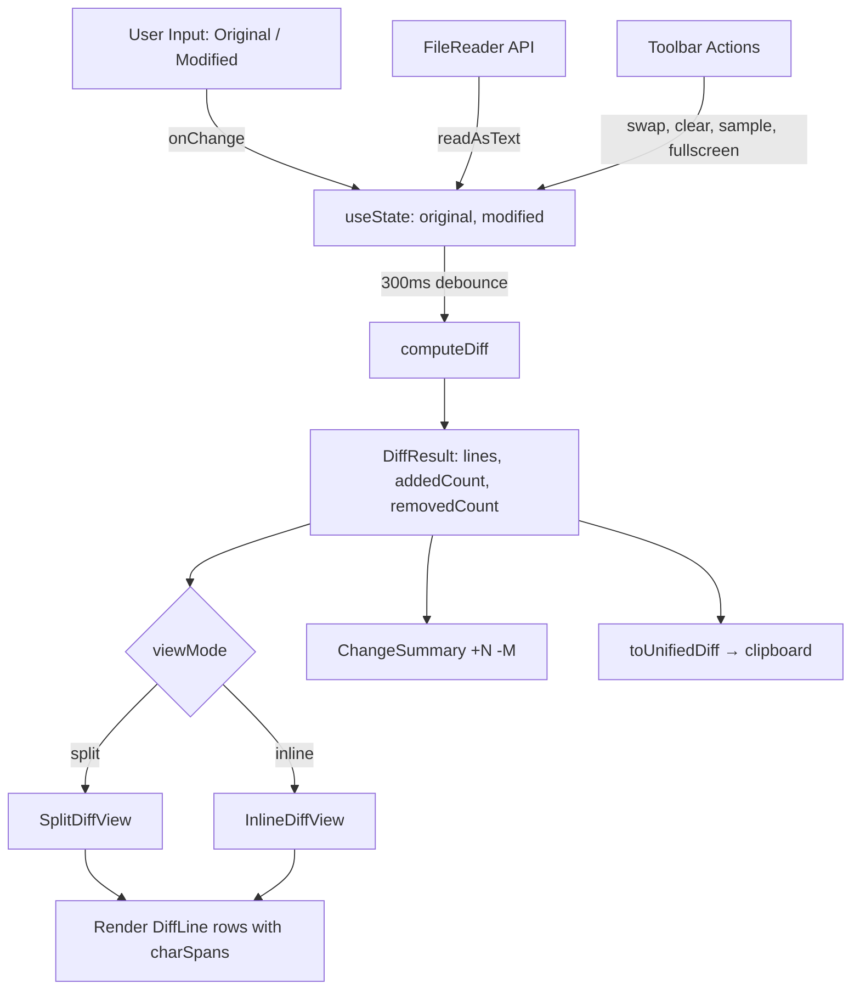

# Design Document: Diff Checker

## Overview

The Diff Checker is a client-side developer utility that computes and renders line-level and character-level differences between two text inputs. It follows the exact same structural pattern as all existing C³ MindLoop tools: a `*Tool.tsx` component with a toolbar-first layout, a `*Page.tsx` view with a single H1, a Next.js App Router route page, and registration in the tools listing.

All diff computation runs in the browser using a pure TypeScript Myers/LCS implementation with no external diff libraries and no network calls. The tool renders differences in both a split (side-by-side) view and an inline (unified) view, with synchronized scrolling, character-level intra-line highlighting, file upload, and clipboard copy of unified diff output.

---

## Architecture

### Component Hierarchy

```
app/tools/diff-checker/page.tsx          (Next.js route — metadata + JSON-LD)
  └── app/views/DiffCheckerPage.tsx       (layout shell — breadcrumb + single H1)
        └── app/components/tools/DiffCheckerTool.tsx  (interactive tool)
              └── app/components/tools/diffEngine.ts  (pure diff utility, co-located)
```

### Data Flow

```
User types in Original_Panel or Modified_Panel
  → onChange triggers setOriginal / setModified
  → 300ms debounce fires (useEffect + useRef timer)
  → computeDiff(original, modified) called
  → DiffResult stored in state
  → DiffView re-renders with new result
  → Change_Summary updates from result
```

### Dependency Graph

- `DiffCheckerTool.tsx` imports `computeDiff`, `applyPatch`, `toUnifiedDiff` from `diffEngine.ts`
- `DiffCheckerPage.tsx` imports `DiffCheckerTool`
- `page.tsx` imports `DiffCheckerPage` and `seoConfig.diffChecker`
- `app/lib/constants.ts` gets a new entry in `PRODUCTS_LIST`
- `app/config/seo.config.ts` gets a new `diffChecker` key

No new dependencies are introduced. No external diff library is added.

---

## Components and Interfaces

### diffEngine.ts

Co-located at `app/components/tools/diffEngine.ts`. Exports only pure functions — no React, no DOM, no side effects.

```typescript
// The type of a single line in the diff output
export type DiffLineType = 'added' | 'removed' | 'unchanged';

// A character-level span within a line
export interface CharSpan {
  text: string;
  changed: boolean; // true → apply intra-line highlight background
}

// A single line in the diff output
export interface DiffLine {
  type: DiffLineType;
  text: string;
  // Original file line number (1-based). null for pure 'added' lines in split mode.
  origLineNo: number | null;
  // Modified file line number (1-based). null for pure 'removed' lines in split mode.
  modLineNo: number | null;
  // Character-level spans, present only when type !== 'unchanged' and a counterpart exists.
  // If undefined, render the full line without intra-line highlighting.
  charSpans?: CharSpan[];
}

// Top-level result returned by computeDiff
export interface DiffResult {
  lines: DiffLine[];
  addedCount: number;
  removedCount: number;
}

// Main entry point
export function computeDiff(original: string, modified: string): DiffResult;

// Apply the diff result back to original to reconstruct modified.
// Used for round-trip property testing.
export function applyPatch(original: string, result: DiffResult): string;

// Serialize DiffResult to a standard unified diff string.
// Used by the "Copy Diff" toolbar action.
export function toUnifiedDiff(original: string, modified: string, result: DiffResult): string;
```

### DiffCheckerTool.tsx

Located at `app/components/tools/DiffCheckerTool.tsx`. Client component (`'use client'`). Manages all interactive state via `useState` and `useRef`. No heading elements inside this component.

**Props:** none (self-contained).

**Internal state:**

```typescript
// Input state
const [original, setOriginal] = useState<string>('');
const [modified, setModified] = useState<string>('');

// Diff output state
const [diffResult, setDiffResult] = useState<DiffResult | null>(null);

// View mode
type ViewMode = 'split' | 'inline';
const [viewMode, setViewMode] = useState<ViewMode>('split');

// Toolbar transient states
const [copied, setCopied] = useState<boolean>(false);
const [copyError, setCopyError] = useState<boolean>(false);

// Fullscreen
const [isFullScreen, setIsFullScreen] = useState<boolean>(false);

// File upload errors (one per panel)
const [origFileError, setOrigFileError] = useState<string | null>(null);
const [modFileError, setModFileError] = useState<string | null>(null);

// Refs
const debounceRef = useRef<ReturnType<typeof setTimeout> | null>(null);
const origScrollRef = useRef<HTMLDivElement>(null);
const modScrollRef = useRef<HTMLDivElement>(null);
const scrollingRef = useRef<'orig' | 'mod' | null>(null);
const origFileRef = useRef<HTMLInputElement>(null);
const modFileRef = useRef<HTMLInputElement>(null);
```

### DiffCheckerPage.tsx

Located at `app/views/DiffCheckerPage.tsx`. Client component. Renders the breadcrumb, single H1, `DiffCheckerTool`, `ToolSeoWrapper`, and `CTASection`. Mirrors `Base64Page.tsx` structure exactly.

### app/tools/diff-checker/page.tsx

Next.js App Router page. Exports `metadata: Metadata` with title, description, keywords, canonical, openGraph, and twitter fields from `seoConfig.diffChecker`. Renders `DiffCheckerPage` wrapped in JSON-LD `<script>` tags (SoftwareApplication schema + FAQPage schema).

---

## Data Models

### Myers/LCS Line-Level Diff

The diff engine implements the [Myers diff algorithm](https://neil.fraser.name/writing/diff/) over a string array (lines). This produces the minimal edit script: the shortest sequence of additions and removals that transforms original lines into modified lines.

**Algorithm outline:**

```typescript
// 1. Split inputs into line arrays
const origLines = original.split('\n');
const modLines = modified.split('\n');

// 2. Compute LCS using Myers O(ND) algorithm
//    Returns an edit script: array of { op: 'equal' | 'insert' | 'delete', origIdx, modIdx }
const editScript = myersDiff(origLines, modLines);

// 3. Assign line numbers and pair changed lines for char-level diff
//    Consecutive delete/insert pairs are matched 1:1 for intra-line highlighting
const lines: DiffLine[] = buildDiffLines(editScript, origLines, modLines);

// 4. Compute addedCount / removedCount
```

**Line pairing for character-level diff:** After the edit script is computed, consecutive `delete`+`insert` pairs within the same hunk are matched positionally. The first removed line is paired with the first added line, second with second, etc. Unmatched lines (when counts differ within a hunk) get no `charSpans`.

### Character-Level Diff

Applies the same Myers algorithm at the character level between two paired line strings. Each character is treated as a single Unicode code point (using `[...str]` spread, not `str.split('')`, to correctly handle multi-byte code points like emoji).

```typescript
function charDiff(a: string, b: string): { aSpans: CharSpan[]; bSpans: CharSpan[] }
```

Returns two span arrays: one for the `removed` line (`aSpans`), one for the `added` line (`bSpans`). Unchanged character runs have `changed: false`, changed character runs have `changed: true`.

### Unified Diff Format

`toUnifiedDiff` produces a string in the standard unified diff format (`--- a\n+++ b\n@@ ... @@\n...`) with 3 lines of context. This is the format copied to clipboard.

---

## State Management Design

Local `useState` throughout — consistent with all other tools on the platform. No Redux, no React Context, no `useReducer`.

**Debounce pattern** (mirrors `JsonFormatterTool`):

```typescript
useEffect(() => {
  if (debounceRef.current) clearTimeout(debounceRef.current);
  debounceRef.current = setTimeout(() => {
    const result = computeDiff(original, modified);
    setDiffResult(result);
  }, 300);
  return () => {
    if (debounceRef.current) clearTimeout(debounceRef.current);
  };
}, [original, modified]);
```

The diff fires 300ms after the last keystroke in either panel. There is no loading indicator — the requirement states computation must not block input.

**Fullscreen effect** (mirrors `Base64Tool` and `JsonFormatterTool`):

```typescript
useEffect(() => {
  const handleKey = (e: KeyboardEvent) => {
    if (e.key === 'Escape' && isFullScreen) setIsFullScreen(false);
  };
  const navbar = document.querySelector('header') as HTMLElement | null;
  if (isFullScreen) {
    document.body.style.overflow = 'hidden';
    if (navbar) navbar.style.display = 'none';
    window.addEventListener('keydown', handleKey);
  } else {
    document.body.style.overflow = '';
    if (navbar) navbar.style.display = '';
  }
  return () => {
    document.body.style.overflow = '';
    if (navbar) navbar.style.display = '';
    window.removeEventListener('keydown', handleKey);
  };
}, [isFullScreen]);
```

---

## Diff Engine Algorithm Design

### Myers/LCS Core

The Myers algorithm finds the shortest edit script (minimum number of insertions and deletions) between two sequences. It operates in O(ND) time where N is the sum of sequence lengths and D is the edit distance.

Implementation uses the "forward" Myers algorithm with a diagonal vector `V` indexed by `k = x - y`. The algorithm explores edit graph diagonals to find the shortest path from `(0,0)` to `(n,m)`.

```typescript
function myersDiff<T>(
  a: T[],
  b: T[],
  eq: (x: T, y: T) => boolean = (x, y) => x === y
): Array<{ op: 'equal' | 'insert' | 'delete'; aIdx: number; bIdx: number }> {
  // Myers O(ND) with backtracking
  // Returns minimal edit script
}
```

The same `myersDiff<T>` generic is reused for both line-level (T = string) and character-level (T = string, single code point) diffing.

### Character-Level Diff

```typescript
function charDiff(a: string, b: string): { aSpans: CharSpan[]; bSpans: CharSpan[] } {
  const aChars = [...a]; // Unicode code point split
  const bChars = [...b];
  const script = myersDiff(aChars, bChars);
  // Coalesce adjacent equal/changed ops into spans
  return buildCharSpans(script, aChars, bChars);
}
```

### applyPatch (for testing)

```typescript
export function applyPatch(original: string, result: DiffResult): string {
  return result.lines
    .filter(l => l.type !== 'removed')
    .map(l => l.text)
    .join('\n');
}
```

This function is exported specifically to enable round-trip property testing. It reconstructs the modified text by taking all non-removed lines.

---

## Rendering Strategy

### Split View

Two scrollable `div` columns rendered side by side (`grid-cols-2` on `lg:`, stacked on mobile). Each column has:
- A column header (`Original` / `Modified`) with file upload button
- A scrollable diff body (`ref={origScrollRef}` / `ref={modScrollRef}`)
- Each row: line number cell + gutter symbol cell (`+`/`-`/` `) + line content cell

Rows are rendered with `<div>` elements, not `<table>`, to keep CSS alignment flexible. A fixed-width `w-10` line number column uses `font-mono text-xs text-neutral-500`. The content area is `font-mono text-xs`.

**Sync scroll** (mirrors `JsonFormatterTool.syncScroll`):

```typescript
const handleOrigScroll = () => {
  if (scrollingRef.current === 'mod' || !origScrollRef.current || !modScrollRef.current) return;
  scrollingRef.current = 'orig';
  const orig = origScrollRef.current;
  const mod = modScrollRef.current;
  const scrollable = orig.scrollHeight - orig.clientHeight;
  if (scrollable > 0) {
    mod.scrollTop = (orig.scrollTop / scrollable) * (mod.scrollHeight - mod.clientHeight);
  }
  setTimeout(() => { scrollingRef.current = null; }, 50);
};
```

Symmetrically defined for `handleModScroll`. Both handlers attached via `onScroll` prop.

**Empty rows for alignment:** In split mode, when a hunk has 3 removed lines and 1 added line, the right column renders 2 empty placeholder rows to keep the panels aligned. Empty rows use the same height as content rows via `min-h-[1.5rem]`.

### Inline View

A single-column view. Within each hunk, removed lines render first (with `-` gutter, `bg-red-950`), then added lines (`+` gutter, `bg-emerald-950`). Unchanged lines render with no background tint. This produces a unified-diff-style flow.

Line numbers in inline mode: original line number shown for `removed` lines, modified line number shown for `added` lines, both shown for `unchanged` lines (or just the modified number — either is acceptable per requirements).

### Character-Level Spans

Within a changed line that has `charSpans`, the text is rendered as a sequence of `<span>` elements:

```tsx
{line.charSpans.map((span, i) => (
  <span
    key={i}
    className={span.changed
      ? (line.type === 'added' ? 'bg-emerald-800' : 'bg-red-800')
      : undefined
    }
  >
    {span.text}
  </span>
))}
```

Lines without `charSpans` render the text content directly.

### Change Summary

Rendered inline in the toolbar row (or immediately below it), not in a separate floating section. Example layout:

```tsx
<div className="flex items-center gap-2 font-mono text-xs">
  <span className="text-emerald-400">+{diffResult.addedCount}</span>
  <span className="text-red-400">-{diffResult.removedCount}</span>
  {diffResult.addedCount === 0 && diffResult.removedCount === 0 && (
    <span className="text-neutral-500">No differences</span>
  )}
</div>
```

---

## File Upload Flow

Each panel has an independent hidden `<input type="file">` and a corresponding `useRef`:

```typescript
const origFileRef = useRef<HTMLInputElement>(null);
const modFileRef = useRef<HTMLInputElement>(null);
```

Upload buttons trigger `origFileRef.current?.click()` / `modFileRef.current?.click()`.

**FileReader handler (per panel):**

```typescript
const handleFileUpload = (
  e: React.ChangeEvent<HTMLInputElement>,
  panel: 'orig' | 'mod'
) => {
  const file = e.target.files?.[0];
  if (!file) return;
  const reader = new FileReader();
  reader.onload = (evt) => {
    const content = evt.target?.result as string;
    if (panel === 'orig') {
      setOriginal(content);
      setOrigFileError(null);
    } else {
      setModified(content);
      setModFileError(null);
    }
  };
  reader.onerror = () => {
    const msg = 'Could not read file. Binary files are not supported.';
    if (panel === 'orig') setOrigFileError(msg);
    else setModFileError(msg);
  };
  reader.readAsText(file); // All plain text files regardless of extension
  e.target.value = ''; // Reset so same file can be re-selected
};
```

File errors display as inline `text-red-300 text-xs font-mono` messages beneath the affected panel header. Existing panel content is preserved on error.

All file reading is `FileReader.readAsText()` — no upload, no server call.

---

## Clipboard / Copy Flow

The "Copy Diff" action writes the unified diff output to the system clipboard:

```typescript
const handleCopyDiff = async () => {
  if (!diffResult) return;
  const unified = toUnifiedDiff(original, modified, diffResult);
  try {
    await navigator.clipboard.writeText(unified);
    setCopied(true);
    setTimeout(() => setCopied(false), 2000);
  } catch {
    setCopyError(true);
    setTimeout(() => setCopyError(false), 2000);
  }
};
```

Button label transitions: default → `Copied!` (success, 2000ms) or `Error` (failure, 2000ms) → default. Matches the 2000ms pattern used in `Base64Tool` and `JsonFormatterTool`.

---

## Fullscreen Flow

Identical to the pattern in `Base64Tool.tsx` and `JsonFormatterTool.tsx`:

- `isFullScreen` boolean state
- Toggle button in toolbar: `<Maximize2>` / `<Minimize2>` icons from Lucide React
- `useEffect` on `isFullScreen`:
  - Set `document.body.style.overflow = 'hidden'` + `document.querySelector('header').style.display = 'none'` on enter
  - Restore on exit
  - `keydown` listener for `Escape` dismissal
- Container class: `fixed inset-0 z-[9999] overflow-hidden` when fullscreen, `w-full rounded-lg shadow-2xl` otherwise
- Toolbar becomes `sticky top-0 z-[10000] bg-neutral-950` in fullscreen

---

## Color Scheme and Tailwind Tokens

| Element | Token |
|---|---|
| Primary background | `bg-neutral-950` |
| Panel borders | `border-neutral-800` |
| Active/accent controls | `bg-[#1D9BF0]` text `text-white` |
| Toolbar background | `bg-neutral-900` |
| Added line background | `bg-emerald-950` |
| Removed line background | `bg-red-950` |
| Added intra-line highlight | `bg-emerald-800` |
| Removed intra-line highlight | `bg-red-800` |
| Gutter `+` symbol | `text-emerald-400` |
| Gutter `-` symbol | `text-red-400` |
| Line numbers | `text-neutral-500` |
| Unchanged line background | none (inherits `bg-neutral-950`) |
| Footer privacy note | `text-neutral-400` `font-mono` `text-[11px]` |
| Panel content | `font-mono text-xs` |
| Error text | `text-red-300` |
| File error bg | `bg-red-950/40 border border-red-900/80` |
| Clear button hover | `hover:bg-red-950 hover:text-red-300` |

No neon green (`#00FF00`). No high-saturation backgrounds. No decorative badges or spinning graphics.

---

## Mermaid Diagram



---

## Error Handling

| Scenario | Handling |
|---|---|
| Both panels empty | `computeDiff('', '')` returns `{ lines: [], addedCount: 0, removedCount: 0 }`. Empty Diff_View, no error. |
| One panel empty, other has content | Normal diff — all lines classified as added or removed. |
| File read error (binary or I/O failure) | `FileReader.onerror` sets `origFileError` / `modFileError`. Inline error message shown below panel. Existing content unchanged. |
| Clipboard write failure | `setCopyError(true)` for 2000ms. Button shows `Error` label. |
| Very large inputs | `computeDiff` runs synchronously in the debounce callback. No hard size limit. For inputs large enough to block the main thread (>100k lines), the 300ms debounce naturally limits recompute frequency. Future optimization: move to a `useWorker` pattern if needed. |

---

## Testing Strategy

### PBT Applicability Assessment

The diff engine (`diffEngine.ts`) is a set of **pure functions** with clear input/output behavior. Correctness properties hold universally across all input pairs — including empty strings, Unicode content, identical inputs, and completely unrelated inputs. PBT is directly appropriate here.

UI behavior (rendering, toolbar actions, scroll sync) uses example-based tests only.

### Property-Based Testing Library

Use **[fast-check](https://github.com/dubzzz/fast-check)** for TypeScript/Jest. It is well-maintained, zero-runtime-download, and integrates natively with Jest/Vitest.

```bash
npm install --save-dev fast-check
```

Each property test runs a minimum of **100 iterations**.

Tag format for each test: `// Feature: diff-checker, Property N: <property_text>`

### Unit Tests (example-based)

- `computeDiff('', '')` → `{ lines: [], addedCount: 0, removedCount: 0 }`
- `computeDiff('a', 'a')` → 1 unchanged line, both counts 0
- `computeDiff('a\nb', 'a\nc')` → line 1 unchanged, line 2 removed (`b`), line 2 added (`c`)
- Toolbar: Swap action exchanges panel contents
- Toolbar: Clear action resets both panels and diffResult
- Toolbar: Load Sample populates known content in both panels
- View mode toggle: switching split↔inline preserves `original` and `modified` state
- File upload: `FileReader` success populates panel; `FileReader.onerror` sets error, preserves existing content
- Change summary: `+0 -0` with "No differences" label when inputs are identical
- Fullscreen: `isFullScreen` toggle hides/shows header element

### Property Tests

See Correctness Properties section below.

---

## Correctness Properties

*A property is a characteristic or behavior that should hold true across all valid executions of a system — essentially, a formal statement about what the system should do. Properties serve as the bridge between human-readable specifications and machine-verifiable correctness guarantees.*

### Property 1: Diff Round-Trip

*For any* pair of original and modified strings, applying the diff result as a patch to the original string must reconstruct the modified string exactly.

Formally: `applyPatch(original, computeDiff(original, modified)) === modified`

This property validates the fundamental correctness of the Myers algorithm implementation. It catches bugs in line classification (wrong `added`/`removed` assignments), missed lines, duplicate lines, and whitespace stripping.

**Validates: Requirements 2.6, 1.4**

### Property 2: Output Type Invariant

*For any* pair of original and modified strings, every `DiffLine` in `computeDiff(original, modified).lines` must have a `type` that is exactly one of `'added'`, `'removed'`, or `'unchanged'`.

This is a structural invariant on the output that should hold regardless of input content.

**Validates: Requirements 2.1**

### Property 3: Change Summary Consistency

*For any* pair of original and modified strings, the `addedCount` field of the result must equal the number of lines with `type === 'added'`, and `removedCount` must equal the number of lines with `type === 'removed'`.

Formally:
```
result.addedCount === result.lines.filter(l => l.type === 'added').length
result.removedCount === result.lines.filter(l => l.type === 'removed').length
```

**Validates: Requirements 7.1, 7.2**

### Property 4: Line Number Monotonicity

*For any* pair of original and modified strings, the sequence of non-null `origLineNo` values across all diff lines (in order) must be strictly increasing, and the sequence of non-null `modLineNo` values must also be strictly increasing.

This ensures line numbers are never duplicated, skipped illogically, or reordered — regardless of the diff shape.

**Validates: Requirements 6.1, 6.2, 6.3, 6.4**

### Property 5: Character-Level Diff Present for Paired Changed Lines

*For any* pair of original and modified strings, for every `DiffLine` in the result that has `type === 'removed'` or `type === 'added'` **and** has a non-null counterpart line number in the opposite panel, the `charSpans` field must be defined and non-empty.

This validates that the pairing and character-level diffing logic runs whenever a counterpart exists.

**Validates: Requirements 3.1, 3.3**

---

## Files to Create

| File | Action |
|---|---|
| `app/components/tools/diffEngine.ts` | Create — pure diff utility |
| `app/components/tools/DiffCheckerTool.tsx` | Create — interactive React component |
| `app/views/DiffCheckerPage.tsx` | Create — layout shell with H1 |
| `app/tools/diff-checker/page.tsx` | Create — Next.js route with metadata + JSON-LD |

## Files to Modify

| File | Change |
|---|---|
| `app/lib/constants.ts` | Add `diff-checker` entry to `PRODUCTS_LIST` |
| `app/config/seo.config.ts` | Add `diffChecker` key to `seoConfig` + export `diffCheckerSchema` |

---

## Registration Details

### PRODUCTS_LIST entry (`app/lib/constants.ts`)

```typescript
{
  id: 'diff-checker',
  nameKey: 'Diff Checker',
  descKey: 'Compare two text or code files side by side with line-level and character-level diff highlighting. 100% client-side, zero upload.',
  status: 'live',
  category: 'utilities',
  icon: 'GitCompare',  // or 'Diff' — confirm available in lucide-react version
  techStack: ['Myers Diff', 'LCS Algorithm', 'Local Processing']
}
```

### seo.config.ts entry

```typescript
diffChecker: {
  title: 'Diff Checker — Compare Text & Code Online | Free, 100% Private',
  description:
    'Free online diff checker. Compare two versions of code, JSON, YAML, or plain text side by side with line-level and character-level highlighting. 100% client-side, zero server upload.',
  keywords: [
    'diff checker', 'text diff online', 'code diff tool', 'compare two files online',
    'diff viewer', 'line diff checker', 'code comparison tool', 'unified diff online',
    'diff tool free', 'online diff checker', 'file diff compare',
    '100% Private', 'Client-Side Execution', 'No Server Upload', 'GDPR Compliant',
    'json diff checker', 'yaml diff tool', 'compare text files online',
    'character level diff', 'side by side diff', 'inline diff viewer',
    'C³ MindLoop diff checker', 'ccube diff tool',
  ],
  canonical: `${BASE_URL}/tools/diff-checker`,
  openGraph: {
    title: 'Diff Checker — Compare Text & Code Online | C³ MindLoop',
    description:
      'Side-by-side and inline diff viewer with character-level highlighting. 100% Private, zero server upload.',
    url: `${BASE_URL}/tools/diff-checker`,
    images: [{ url: defaultOgImage, width: 1200, height: 630, alt: 'Diff Checker - C³ MindLoop' }],
  },
  twitter: {
    title: 'Diff Checker — Compare Text & Code | C³ MindLoop',
    description: 'Side-by-side diff with character-level highlighting. 100% Private & Client-Side.',
    images: [defaultOgImage],
  },
}
```

### JSON-LD schema (`app/tools/diff-checker/page.tsx`)

Two schemas: `SoftwareApplication` (mirrors `base64EncoderSchema` structure) and `FAQPage` with 3–4 questions about how the diff tool works and its privacy model.

### Route (`app/tools/diff-checker/page.tsx`)

```typescript
import type { Metadata } from 'next';
import { DiffCheckerPage } from '@/app/views/DiffCheckerPage';
import { seoConfig } from '@/app/config/seo.config';

const { diffChecker } = seoConfig;

export const metadata: Metadata = {
  title: diffChecker.title,
  description: diffChecker.description,
  keywords: diffChecker.keywords,
  alternates: { canonical: diffChecker.canonical },
  openGraph: diffChecker.openGraph,
  twitter: { card: 'summary_large_image', ...diffChecker.twitter },
};

export default function Page() {
  return (
    <>
      <script type="application/ld+json" dangerouslySetInnerHTML={{ __html: JSON.stringify(diffCheckerSchema) }} />
      <script type="application/ld+json" dangerouslySetInnerHTML={{ __html: JSON.stringify(diffCheckerFaqSchema) }} />
      <DiffCheckerPage />
    </>
  );
}
```
